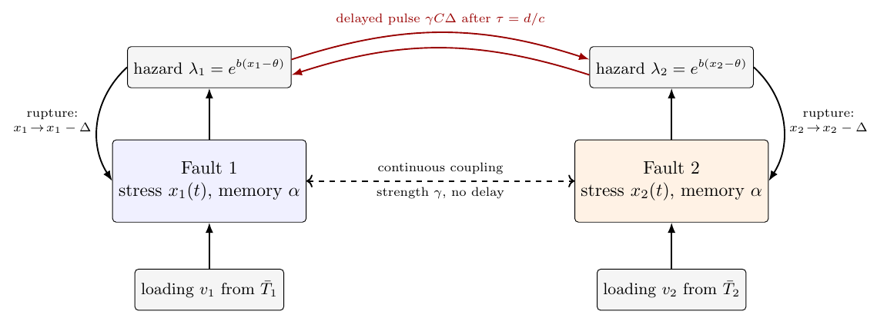
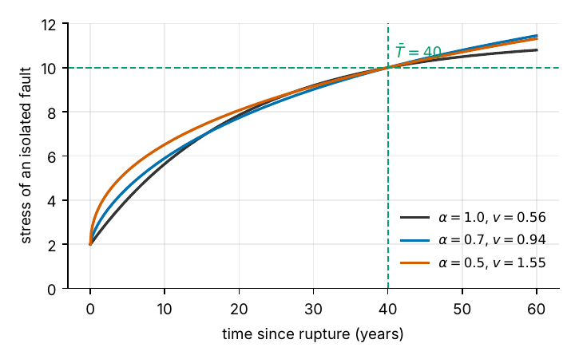
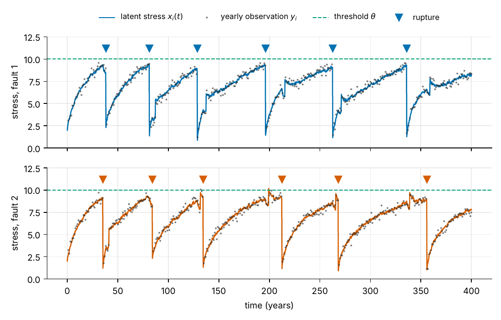
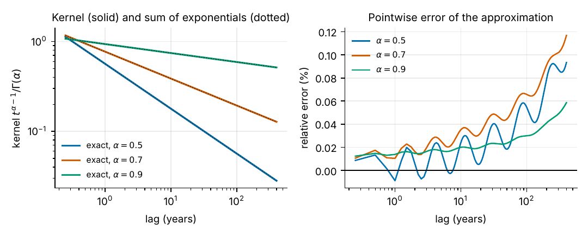
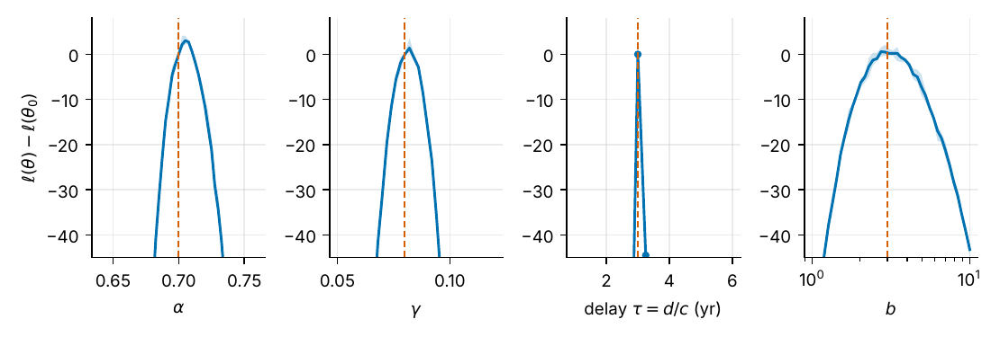

<p align="center">
  <picture>
    <source media="(prefers-color-scheme: dark)" srcset="assets/logo-dark.svg">
    
  </picture>
</p>

# Fractional delayed impulsive model of interacting earthquake faults

A stochastic model of two interacting faults in which

* tectonic stress has **long memory** (Caputo fractional order $\alpha\in(0,1]$),
* ruptures are **impulses** that reset the stress of the failing fault,
* each rupture sends a **delayed stress pulse** to the neighbouring fault after $\tau=d/c$,
* ruptures occur at a stress-dependent **hazard**,

so the output is a **probability of rupture in a future window**, not a single predicted date.
Parameters $(\alpha,\gamma,c,b)$ are estimated by maximum likelihood, the likelihood being computed with a bootstrap
particle filter on a sum-of-exponentials (Markov) representation of the fractional kernel.
The repository contains the model, the inference code, a complete statistical validation protocol and the LaTeX article.

<p align="center">
  
</p>

## 1. The model

Let $x_i(t)$ be the stress on fault $i\in\{1,2\}$, $j\neq i$. Between ruptures it solves the Volterra equation

$$
x_i(t)=x_i(0)+\frac{1}{\Gamma(\alpha)}\int_0^t (t-s)^{\alpha-1}\,F_i\big(x(s)\big)\,\mathrm{d}s+J_i(t),
\qquad x_i(0)=\rho\theta,
$$

with drift and noise

$$
F_i = v_i-\beta x_i+\gamma\,(x_j-x_i)+\sigma_x\,\xi_i ,
$$

where $v_i$ is the loading rate, $\beta$ a relaxation rate, $\gamma\ge 0$ the coupling strength and $\xi_i$ white noise.
For $\alpha=1$ this is the ordinary memoryless ODE. The jump term $J_i(t)$ is kept **outside** the memory integral.

**Hazard, rupture and delayed pulse.** Fault $i$ ruptures at rate

$$
\lambda_i(t)=\lambda_0\exp\big(b\,(x_i(t)-\theta)\big),\qquad \lambda_0=1 .
$$

At a rupture of fault $i$:

$$
x_i\;\mapsto\;x_i-\Delta,\qquad \Delta=\theta(1-\rho),
$$

and fault $j$ receives a pulse of size $\gamma C\Delta$ after the travel time $\tau=d/c$
($d$ = distance between the faults, $c$ = propagation speed). The delay acts **only on the pulse**.

**Loading calibration.** For an isolated noiseless fault the solution is
$x(t)=\frac{v}{\beta}\big(1-E_\alpha(-\beta t^\alpha)\big)+\rho\theta\,E_\alpha(-\beta t^\alpha)$
($E_\alpha$ = Mittag-Leffler function). Requiring $x(\bar T_i)=\theta$ for a reference recurrence time $\bar T_i$ gives

$$
v_i=\beta\theta\;\frac{1-\rho\,E_\alpha(-\beta\bar T_i^{\,\alpha})}{1-E_\alpha(-\beta\bar T_i^{\,\alpha})} ,
$$

so the loading rate moves with $\alpha$ and the nominal recurrence time stays at $\bar T_i$.

**Observations.** Rupture times (catalogue) and a yearly noisy stress proxy
$y_{i,k}=x_i(t_k)+\sigma_y\varepsilon_{i,k}$, $\varepsilon\sim N(0,1)$.

<p align="center">
  
  
</p>

## 2. Inference

**Sum of exponentials.** The kernel is completely monotone,

$$
\frac{t^{\alpha-1}}{\Gamma(\alpha)}=\frac{\sin(\pi\alpha)}{\pi}\int_0^\infty s^{-\alpha}e^{-st}\,\mathrm{d}s\;\approx\;\sum_{k=1}^{K}w_k\,e^{-s_k t},
$$

so the Volterra equation becomes a Markov system with $K=21$ auxiliary states per fault (plus a tail term at $s=0$), and
simulation / filtering cost is linear in time. The data are generated with the **exact** memory kernel, so the
approximation is tested rather than assumed (no "inverse crime").

<p align="center">
  
</p>

**Likelihood and estimation.** Bootstrap particle filter (100 particles, systematic resampling when
$\mathrm{ESS}<P/2$, common random numbers across parameter values). The parameters are optimised on the scale
$(\mathrm{logit}\,\alpha,\log\gamma,\log c,\log b)$ by Nelder–Mead with restarts. Fixed quantities:
$\beta=0.05,\ \theta=10,\ \rho=0.2,\ \bar T=(40,45),\ d=30,\ C=3,\ \sigma_x=0.1,\ \lambda_0=1$.

> **Delay resolution.** Pulses are applied on the time grid ($h=0.25$ yr), so the likelihood is piecewise constant in $c$ and
> $\tau=d/c$ is identified only up to the grid step.

<p align="center">
  
</p>

## 3. Statistical validation protocol

All studies use simulated data with known truth, $T=400$ years, true $(\alpha,\gamma,c,b)=(0.7,0.08,10,3)$ ($\tau=3$ yr),
in two scenarios: **S1** $\sigma_y=0.3$ and **S2** $\sigma_y=1.5$.

| Question | Method |
|---|---|
| Can the parameters be recovered? | replication study: bias, SD, RMSE, relative RMSE; a replicate is *valid* if $\hat\ell\ge\ell(\vartheta_0)-2$ |
| Is there memory? $H_0:\alpha=1$ | LR statistic $\Lambda=2\{\ell(\hat\vartheta)-\ell(\hat\vartheta_{H_0})\}$; $\alpha=1$ is a **boundary** (asymptotically $\tfrac12\chi^2_0+\tfrac12\chi^2_1$), so the null is calibrated by **parametric bootstrap** |
| Is there interaction? $H_0:\gamma=0$ | LR statistic; also a boundary, and $c$ is unidentified under $H_0$ (Davies problem), so the $\chi^2$ reference is only a rough guide |
| Shape of the evidence on $\alpha$ | profile likelihood over $\alpha\in[0.4,1]$ (no formal intervals: particle-filter noise is of the order of the usual deviance thresholds) |
| Wrong reference time? | refit with $\bar T\times 0.8$ and $\times 1.25$ |
| Do forecasts help? | out-of-sample 5-year window probabilities; Brier score, log score, AUC, reliability, Brier skill vs. Poisson, Weibull renewal and the $\alpha=1$ refit |

The forecast of fault $i$ at time $t$ is the filtering-based Monte-Carlo estimate of

$$
p_i(t)=\mathbb{P}\big(\text{fault } i \text{ ruptures in } (t,t+W]\;\big|\;\text{data up to } t\big),\qquad W=5\ \text{yr}.
$$

## 4. Results so far (pilot run only)

The numbers below come from a **small pilot** (4 replicates per scenario, 8 null datasets for the bootstrap,
3 replicates for the reference-time study). They show that the method works; they are **not** precise operating characteristics.

| Scenario | Valid fits | $\hat\alpha$ | $\hat\gamma$ | $\hat c$ | $\hat b$ |
|---|---|---|---|---|---|
| S1, $\sigma_y=0.3$ (truth: 0.7 / 0.08 / 10 / 3) | 3 of 4 | 0.701 | 0.077 | 9.86 | 2.52 |
| S2, $\sigma_y=1.5$ | 1 of 4 | 0.698 | 0.074 | 9.82 | 2.33 |

* **Memory and coupling are detected** with power 100% in both scenarios (LR statistics of the order of $10^2$–$10^3$).
* **Wrong $\bar T$** lowers the maximised log-likelihood by about 112 (×0.8) and 140 (×1.25) units on average and biases
  $\hat\alpha$ upwards when $\bar T$ is too large; the *presence* of memory is robust, its *size* is not.
* **Forecasts (S1):** Brier skill vs. Poisson $+37.6\%$ for the fractional model, $+11.8\%$ for Weibull renewal, $-7.2\%$ without memory.

**Known limitations.**
1. Under noisy observations (S2) the optimiser often stalls (3 of 4 fits invalid) – an optimisation problem, not evidence about the data.
2. The forecast comparison is **not information-matched**: the fractional model uses the stress readings, the baselines only the catalogue.
3. Stress is observed directly (with noise) in the simulations – an optimistic assumption; real data give only proxies.
4. The bootstrap critical values use only 8 null datasets and are not reliable yet.
5. The real-fault map is only an illustration of geometry; the pair currently chosen from the GEM database is not a proper pair of neighbouring faults.
6. No head-to-head comparison with ETAS or the linked stress-release model has been run.

## 5. Related work

Renewal / Brownian-passage-time models (Matthews et al., 2002); stress-release and linked stress-release models
(Vere-Jones, 1978; Bebbington & Harte, 2003); Hawkes and ETAS (Hawkes, 1971; Ogata, 1988); Coulomb stress transfer and rate-and-state
seismicity (Stein, 1999; Dieterich, 1994); fractional viscoelastic wave propagation (Demir & Kocyiğit, 2025); a hierarchical fractional $N$-body
stress framework (Chishtie, 2026, EGUsphere preprint, no delay / inference / forecasting). A comparison table is in the article.
*References were written from memory and must be verified before submission.*

## 6. Repository layout

| Path | Content |
|---|---|
| `stats/recovery_study.py` | model, exact-memory data generator, reference particle filter (numpy), numerical checks |
| `stats/fastpf.py` | numba particle filter and window-forecast filter |
| `stats/stats_study.py` | replication study, LR tests (bootstrap for $\alpha=1$), profile likelihood, forecast scores |
| `stats/misspec.py` | robustness to a wrong reference recurrence time |
| `stats/fig_basic.py`, `stats/analyze.py` | figures and LaTeX tables |
| `stats/fault_map.py` | map of two real fault traces (GEM Global Active Faults Database, `cartopy`) |
| `stats/export_excel.py` | all results in `results.xlsx` |
| `stats/run_all.py` | runs the whole study (S1, S2, bootstrap null, robustness) in a parallel process pool, resumable; can be **shared between several machines** (e.g. desktop + Colab) through a common Drive folder (`--cores 2,8 --me 0/1`) |
| `stats/schematic.tex` | TikZ model schematic |
| `notebooks/` | Colab (Google Drive) and laptop (Jupyter) notebooks that write these files and run everything |
| `paper/article.tex`, `paper/tikz_problem.tex` | the article (needs `stats/figs`, `stats/tabs`, `stats/schematic.tex`) |
| `assets/` (logo, light and dark), `docs/img/` | logo and figures used in this README |

## 7. Run

```bash
pip install -r requirements.txt
cd stats
python fig_basic.py
python stats_study.py --sigy 0.3 --R 24 --B0 40 --npart 100 --out out    # scenario S1 (resumable)
python stats_study.py --sigy 1.5 --R 16 --B0 24 --npart 100 --out out    # scenario S2
python misspec.py 12
python analyze.py && python export_excel.py
python fault_map.py                                                       # needs internet + cartopy
cd ../paper && pdflatex article.tex && pdflatex article.tex
```

Fast way, all cores: `python run_all.py --procs 4 --out out`. Or open a notebook from `notebooks/` (`fault_study_colab_github.ipynb` clones this repository in Colab and runs everything in parallel) (set `MODE='QUICK'` for a few-minute check, `MODE='FULL'` for the full study, about 1.5 h on 2 CPU cores).
Results are written next to the code in `out/` (raw, resumable), `figs/`, `tabs/`, `results.xlsx`.

## 8. How to cite

```bibtex
@misc{almohamad2026fractionalfault,
  author = {Al-Mohamad, Mohamad Yamen},
  title  = {A fractional delayed impulsive model of interacting earthquake faults:
            probabilistic forecasting, inference and statistical validation},
  year   = {2026},
  note   = {Code and manuscript draft, \url{https://github.com/yamenetoo/fractional-delayed-fault-model}}
}
```

## Author

Mohamad Yamen Al-Mohamad — Department of Statistics, University of Tabriz, Tabriz, Iran — `yamenmohamad@tabrizu.ac.ir`.

*Forecasts are probabilities, not predictions. This is research code and must not be used for safety decisions.*
